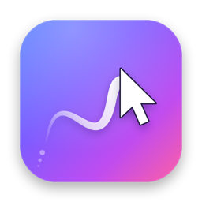
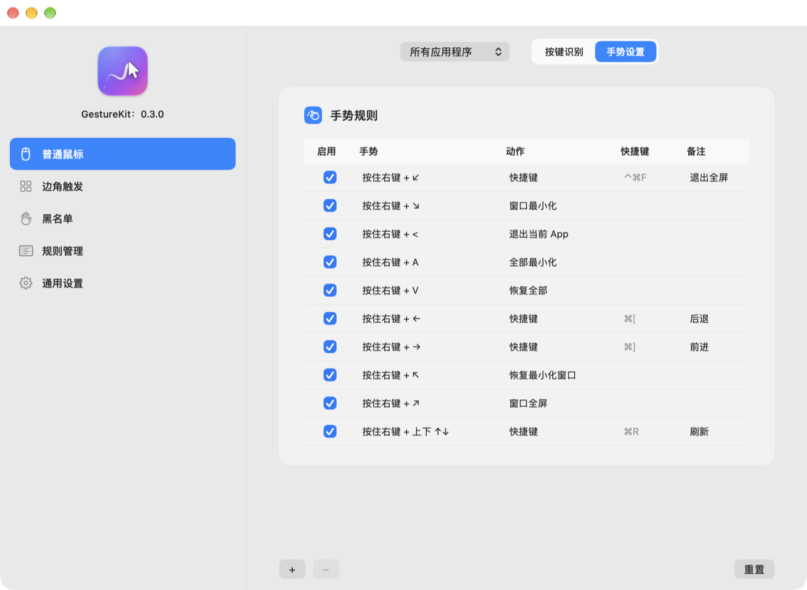

<p align="center"></p>

# GestureKit 0.3 — macOS 鼠标手势

按住右键画一笔，就能后退、刷新、最小化、切全屏……一个小巧的 macOS 菜单栏工具。
Swift 从零实现，不联网、不上报、无第三方依赖。代码在 `Sources/`，开发说明见 `CLAUDE.md` 与 `docs/`。

<p align="center"></p>

## 能做什么

| 类别 | 内容 |
|---|---|
| 鼠标手势 | 按住右键（或左右双键，「通用设置」里选）画形状：4 个直线方向、4 个斜线、**4 个折线（上左 ↑← / 上右 ↑→ / 下左 ↓← / 下右 ↓→）、上下 ↑↓（默认刷新）**、`< >`、A–Z 字母，或**自己画的图形**；得分 > 85 才触发。按住时按字母键也可触发 |
| 边角 | 光标顶到屏幕角落再滚轮（默认右上角调音量、左下角调外接屏亮度） |
| 动作 | 115 个预设：窗口（最小化/全屏/半屏/四分屏/居中/跨屏/吸附到边缘…）、标签页、App 切换、Finder、系统开关、媒体键、键盘背光、截图、鼠标点击；另有快捷键、**打开 App / 网址 / 文件**、**输入文字**、**运行快捷指令**、音量、亮度（含外接屏 DDC） |
| 手势记录 | 最近 200 次手势（笔画缩略图、识别结果、分数），可 👍 / 👎 评价；👎 时选「我想画的是…」就把这一笔学成该手势，选「不该触发」就记成反例——**越用越顺** |
| 防误触 | 没认出来就什么都不做并提示「未识别」；退出 / 关闭类动作需要更高把握（92 分）；GestureKit 自己在最前面时不执行 ⌘Q |
| 其它 | 手势轨迹、动作提示气泡（HUD，调音量时显示当前音量）、窗口吸附、按 App 分组的规则（App 专属优先，其余沿用全局；「普通鼠标」页的应用程序下拉里可「添加应用程序…」）、黑名单、中英文界面 |
| 规则管理 | 设置窗口里增删改；导入/导出；**导入原版 `.BABPreset`**（触控板、妙控鼠标、键盘规则会列入跳过）；每天自动备份（保留 5 份） |

## 安装

```bash
cd ~/Documents/DSH/GestureKit
./scripts/make-signing-cert.sh    # 仅第一次：创建固定签名证书（避免每次更新都要重新授权）
./build.sh --install              # 编译 + 自检 + 签名 + 安装到 /Applications 并启动
```

首次运行会打开**权限向导**：在「系统设置 → 隐私与安全性 → 辅助功能」里打开 GestureKit。
授权后自动生效，不用重启。用了固定证书后，以后更新不会再掉权限。

> **不要和 BetterAndBetter 同时开**：两边都会响应手势，动作会执行两次。

## 使用

- 菜单栏 `◈` → **偏好设置…**：左侧选页面（普通鼠标 / 边角触发 / 黑名单 / 规则管理 / 通用设置），
  「手势设置」页里 `+` 添加规则、双击编辑、`−` 删除，改动立即生效。
- 第一次从 BetterAndBetter 迁移：「规则管理 → 导入规则」，选导出的 `.BABPreset`，按提示合并或覆盖。
- 菜单栏图标可以在「通用设置」里隐藏；隐藏后在访达或启动台里再次打开 GestureKit 即回到设置。
- 想用手势开关勿扰 / 专注模式：先在「快捷指令」App 里建一个「设定专注模式」的快捷指令，
  再用「运行快捷指令」动作调用它（macOS 没有公开接口直接开关勿扰）。

## 可能需要改的系统设置

| 现象 | 处理 |
|---|---|
| 窗口吸附与系统平铺打架（macOS 15+） | 「系统设置 → 桌面与程序坞」关闭「将窗口拖到屏幕边缘以平铺」 |
| 「移到上/下一个桌面」（实验）没反应 | 「系统设置 → 键盘 → 键盘快捷键 → 调度中心」打开「移到左/右侧空间」 |

## 文件位置

| 内容 | 路径 |
|---|---|
| 规则配置 | `~/Library/Application Support/GestureKit/rules.json`（同目录有 `rules.auto-*` / `rules.backup-*` 备份） |
| 日志 | `~/Library/Application Support/GestureKit/gesturekit.log` |

恢复旧配置：「规则管理 → 导入规则」选一份 `rules.backup-*.json` 或 `rules.auto-*.json`，再选「覆盖」。

## 调试参数

```bash
/Applications/GestureKit.app/Contents/MacOS/GestureKit --dry-run              # 动作只记日志不执行
/Applications/GestureKit.app/Contents/MacOS/GestureKit --prefs-page 边角触发   # 启动即打开某个设置页
/Applications/GestureKit.app/Contents/MacOS/GestureKit --permission-wizard   # 打开权限向导
/Applications/GestureKit.app/Contents/MacOS/GestureKit --ddc-probe           # 列出外接屏 DDC 通道（只读）
/Applications/GestureKit.app/Contents/MacOS/GestureKit --ddc-test            # 向每台外接屏查询亮度并打印原始回包（只查询不设置）
/Applications/GestureKit.app/Contents/MacOS/GestureKit --ui-click-test       # 用真实鼠标逐个点设置窗口的侧栏和页签并校验（约 25 秒，期间别动鼠标）
/Applications/GestureKit.app/Contents/MacOS/GestureKit --tap-isolation-test  # 主线程被卡住时，光标事件是否仍然及时处理（约 3 秒）
/Applications/GestureKit.app/Contents/MacOS/GestureKit --preset-check 文件.BABPreset  # 预览原版预设能导入什么、与当前规则的差别（只读）
/Applications/GestureKit.app/Contents/MacOS/GestureKit --selftest            # 运行自检
```

运行这些前先退出正在运行的 GestureKit，否则两个实例会同时响应手势。

## 0.3 精简（2026-10-29）

为聚焦鼠标手势主功能，已移除：触控板手势、平滑滚轮及滚轮方向反转、妙控鼠标、键盘快捷键触发、脚本库（含「运行脚本」动作）、
iCloud 云同步、学习教程 / 免费 Apps / 问题反馈页。首次启动新版时，`rules.json` 里这些功能留下的规则会被清掉
（先备份为 `rules.before-slim-*.json`）。旧代码打包在 `backups/before-slim-*.tgz`。

## 已知限制

- 外接屏亮度只支持 Apple Silicon（DDC/CI）和 Apple 自家显示器；Intel Mac 外接屏不支持。
- 不支持：勿扰模式直接开关（用快捷指令代替）、合盖不睡眠、滚动截图、自动输入密码。

完整状态与剩余工作见 `docs/STATUS.md`，与原版的逐项对照见 `docs/PARITY.md`。
